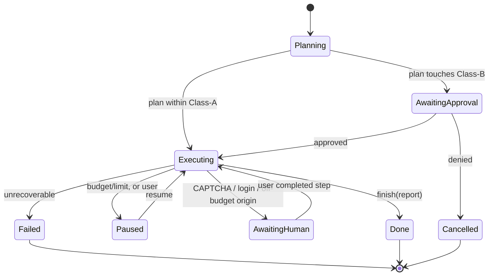

# Perspicacity — Agentic Deep Action and the Shadow Window

**Off-screen execution, accessibility-tree distillation, hybrid local inference, and capability-gated tools**

| Field | Value |
|---|---|
| Document ID | PSC-AGT-004 |
| Revision | 1.0 |
| Status | Proposed — for technical review |
| Parent specification | `ARCHITECTURE.md` (PSC-ARCH-001), §3.3, §4.3–§4.5, §5.5, §6.1 |
| Sibling specifications | `NETWORK.md` (§6.6 shadow isolation), `FINGERPRINT.md` (§3.4 layout determinism), `UTILITIES.md` (macros replay this plan IR) |
| Audience | Agent platform engineers, Gecko content engineers, ML systems engineers, security reviewers |
| Normative language | RFC 2119 (MUST / SHOULD / MAY) |

---

## 0. Conformance to PSC-ARCH-001

| Parent reference | Obligation | This document |
|---|---|---|
| §3.3 | Agent runs in a dedicated, capability-poor, killable sandbox process | §5.6 (`ppx-agent-exec` confinement) |
| §4.2 CIC-1…10 | Typed, capability-scoped IPC with no ambient authority | §7 interface definitions |
| §4.4 | The agent never receives the DOM; it receives a lossy projection | §3 (AXTree distillation is that projection) |
| §4.5.1 | Exactly nine write atoms; no arbitrary JS | §5.2 (tool surface is a closed set) |
| §4.5.2 | Dual planner; untrusted text fills slots only | §5.4 (plan IR with typed slots) |
| §5.5 | Memory typed, labelled, reviewable, never authoritative | §5.5.6 (memory writes carry provenance) |
| §6.1.3 D1, D2, D3, D4 | Projection, split planner, effect set, label lattice | §3.4, §5.3, §5.2, §5.5 |
| §6.5 / ADR-005 | No remote inference in VEIL; remote is an untrusted network party | §4.4 (local-only for `ID-0/1`, OHTTP for `ID-2`) |

---

## 1. What "Deep Action" means architecturally

Fellou's contribution was not a smarter planner; it was the observation that an agent needs a **place to work that is not the user's window** — Fellou calls it a *Shadow Workspace*, built with OS virtualisation so the agent never contends for input focus. Perspicacity implements the same property with browser-level isolation instead of a VM, because a VM boundary would put the agent's traffic outside our network policy, and a separate desktop would put its cookies outside our storage policy.

The subsystem therefore has four physical parts, each corresponding to a section of this document:

| Part | Process | Responsibility | Section |
|---|---|---|---|
| **Shadow host** | `ppx-browser` | Creates off-screen browsing contexts, owns lifetimes, enforces the concurrency governor | §2 |
| **Digest** | `ppx-digest` (utility) | Turns an accessibility snapshot into a compact, deterministic, labelled tree | §3 |
| **Reasoning** | `ppx-infer` | Local quantised models; optional OHTTP path with disclosure | §4 |
| **Actuation** | `ppx-agent-orch` → ARBITER → actuator | Executes only nine atoms, only against granted capabilities | §5 |

The Shadow Window is thus not a UI concept with a hidden browser inside it; it is a **browsing context that has no view**, whose inputs are capability-gated and whose outputs are audited.

---

## 2. Off-screen shadow rendering

### 2.1 Requirements

| # | Requirement | Consequence |
|---|---|---|
| R2-1 | No visible window, no taskbar entry, no focus stealing, no user input contention | The agent must never call `SetFocus` on a real widget |
| R2-2 | Full layout and script execution (it is a *browser*, not a DOM parser) | A hand-rolled HTTP+HTML parser is disqualified: it would diverge from what the user sees and would need its own JS engine to fill forms |
| R2-3 | Deterministic layout geometry across machines | Fixed viewport size (`1280×800` canonical), bundled fonts (`FINGERPRINT.md` §3.4) |
| R2-4 | Painting only when a view is actually needed (L3 vision, screenshots) | Display-list suppression by default; on-demand raster |
| R2-5 | Bounded resource use; killable per task | Per-task process budget, `SIGKILL` from ORCH |
| R2-6 | Never shares a process, storage or circuit with VEIL | Separate class, separate client (`NETWORK.md` §6.6); `SiteInstance ≡ (site, class)` |

R2-2 is the decisive one. Every "DOM distillation" project that starts by parsing HTML with `lol-html` ends up reimplementing selector matching, `getBoundingClientRect`, shadow DOM, and eventually a JS engine. We use the engine's own layout — which is also the only way to know what a human would actually see, and therefore the only way to ground an action on a clickable element.

### 2.2 Gecko realisation: the windowless browser

Gecko already has exactly the primitive needed, used for printing and DevTools: `nsIWindowlessBrowser`. A windowless browser creates a `browsingContext` with a document shell and no `nsIBaseWindow` presentation, so it lays out and runs script but never composites to the screen.

```cpp
// browser/ppx/ShadowHost.cpp
already_AddRefed<nsIWindowlessBrowser> ShadowHost::CreateContext(
    uint64_t aTaskId, const IdentityClass& aClass, const gfx::IntSize& aSize) {
  nsCOMPtr<nsIWindowlessBrowser> browser;
  // 1. Create in a *dedicated* BrowsingContextGroup so the agent context can
  //    never be same-origin-opened by, or share a process with, a VEIL tab.
  RefPtr<BrowsingContext> bc = BrowsingContext::CreateWindowless(
      /* aParent */ nullptr,
      /* aOpener */ nullptr,
      /* aGroup  */ mGroup,             // per-task group
      /* aAttrs  */ OriginAttributesFor(aClass, /* userContextId */ TaskContext(aTaskId)),
      /* aSize   */ aSize);
  // 2. Wire it to a docshell without a widget.
  nsresult rv = bc->GetBrowser(browser);
  NS_ENSURE_SUCCESS(rv, nullptr);
  // 3. Deterministic viewport: the canonical size, not the user's window.
  browser->SetSize(aSize.width, aSize.height, /* aScale */ 1.0f, /* aResolution */ 1.0f);
  return browser.forget();
}
```

Three details carry most of the weight:

1. **A dedicated `BrowsingContextGroup` per task.** This is Gecko's process-allocation unit; a separate group guarantees the agent's documents cannot be placed in a process shared with the user's tabs, which is R2-6 expressed in the engine's own data structure rather than in a policy check.
2. **A unique `userContextId` per task.** Container identity is what makes the ephemeral store and the network isolation token derive differently per task (`NETWORK.md` §6.6) without inventing a parallel mechanism.
3. **`SetSize` with the canonical viewport.** Layout geometry feeds the digest and therefore the model's grounding; a viewport that varies by machine produces different element positions and different model behaviour for the same page — an `I1`-class determinism failure that would show up as inexplicable agent flakiness.

**Painting on demand (R2-4).** By default we suppress display-list construction:

```cpp
// layout/base/ppx/ShadowPaint.cpp
void ShadowPaint::SetPaintMode(nsIPresShell* aShell, PaintMode aMode) {
  switch (aMode) {
    case PaintMode::LayoutOnly:      // default; ~0 GPU cost
      aShell->SetSuppressDisplayport(true);
      aShell->GetPresContext()->SetSuppressPainting(true);
      break;
    case PaintMode::SnapshotOnce:    // L3 vision, user-requested screenshot
      aShell->GetPresContext()->SetSuppressPainting(false);
      aShell->Paint(/* aViewToPaint */ nullptr, nsIFrame::PAINT_DEFAULT, true);
      break;
  }
}
```

Script, network, layout, and form state all work in `LayoutOnly`; only pixels are skipped. That is the correct trade: an agent fills forms and extracts tables from layout, and rarely needs to *see*.

**Background-throttling override (scoped, and why it is safe here).** Gecko throttles timers in background tabs (`dom.min_background_timeout_value`, 1000 ms) to save battery. That would make agent pages fail to progress. Shadow contexts are created with `browsingContext->SetIsActive(false)` yet `SetIsBackgroundThrottled(false)` — a combination reserved for our windowless contexts. This would be a fingerprint if it applied to user tabs; it must never be reachable from a `content` browsing context, which the capability graph enforces (only `ShadowHost` holds the `PpxShadowHost` interface).

### 2.3 Chromium mapping (for completeness)

The architecture chose Gecko, but the contract is engine-neutral and a future Shadow Workspace on Chromium (ADR-001 kill criterion, parent §7.5) maps as follows:

| Gecko | Chromium equivalent | Note |
|---|---|---|
| `nsIWindowlessBrowser` | `WebContents::Create` with `CreateParams::InitAsHiddenBrowserWindow` + a `RenderWidgetHostView` never attached | Hidden `WebContents` still runs layout and script |
| `BrowsingContextGroup` per task | `BrowserContext` per task + `SiteInstance` isolation | Chromium groups processes by `BrowserContext` too |
| `userContextId` | `StoragePartition` per task | — |
| `SetSuppressPainting` | `RenderWidgetHostViewBase::DisableAutoResize` + `BeginFrame` suppression | — |
| `nsIWebNavigation` | `NavigationController` | — |

### 2.4 Concurrency and the governor

Shadow tasks run concurrently, but not unboundedly:

| Limit | Default | Enforcement | Rationale |
|---|---|---|---|
| Concurrent tasks | 3 | ORCH semaphore | Beyond this, the user cannot review receipts |
| Documents per task | 8 | ShadowHost | A 40-tab crawl is a DoS on the user's RAM and a fingerprint amplifier |
| Content processes per task | 2 | Process priority manager | Bounds peak RSS |
| Sites per task | 5 origins (declared up front) | ORCH origin budget | Prevents unbounded wandering; the budget is shown before the task starts |
| Wall clock | 30 min (warn at 20) | ORCH timer | Long-running background tasks are where things go wrong |
| Effects | 240 atoms | ARBITER | Hard cap on side effects per task |

When a limit is hit, the task **pauses and reports**, rather than degrading silently. A paused task with a visible reason is reviewable; a silently truncated task is not.

### 2.5 Isolation from the foreground: the three-bar check

Before a Shadow document is created, ORCH asserts three independent facts, each in a different subsystem, so that a single bug cannot defeat all three:

1. **Process**: the `BrowsingContextGroup` is new (engine).
2. **Storage**: the `userContextId`'s ephemeral store is fresh (CELL).
3. **Network**: the isolation token's class+role is `AgentTask` (Arti).

Any mismatch aborts the task with `ISOLATION_PRECHECK_FAILED` — an error that must never be "retried automatically", because retrying is how a leak becomes intermittent.

---

## 3. DOM-to-accessibility-tree distillation

### 3.1 Where the tree comes from, and why that is the right source

Gecko builds an accessibility tree for assistive technology, and it already solves the two hard problems:

- **What is rendered**: the AX tree excludes `display:none`, zero-size, and non-painted subtrees by construction, because ATs must not announce them either.
- **What it means**: it carries role and accessible name (including computed names from `aria-labelledby`, `alt`, `<label>`, and text alternatives) — exactly the semantics an LLM needs and raw HTML obscures.

It is also **already maintained against hostile content**, which is more than can be said for a new parser. Gecko mirrors the tree to the parent process over `PDocAccessible`; we consume that channel instead of adding a new protocol.

> **Amendment A-11 (proposed).** The parent specification (§4.4) places the Semantic Snapshot Service inside the renderer. This document refines it: the *tree source* is Gecko's content-process accessibility layer, and the *distillation* runs in a new `ppx-digest` utility process. Rationale: (a) no new parser inside the renderer (the renderer stays as small as possible); (b) distillation is parsing of attacker-influenced data, so it belongs outside the TCB; (c) the output still flows through LATTICE unchanged, so §4.3's four gates remain exactly as specified.

```text
content process                ppx-browser                ppx-digest
┌──────────────┐   PDocAccessible   ┌───────────────┐  cap-ipdl  ┌──────────────┐
│ Accessibility │ ────────────────▶ │ AxSnapshot    │ ─────────▶ │ ppx-axdigest │
│ tree (Gecko)  │  bounded binary    │ (Shmem, SoA)  │            │ (Rust)       │
└──────────────┘                    └───────────────┘            └──────┬───────┘
                                                                        │ Digest
                                                                        ▼
                                                                   LATTICE
```

### 3.2 Geometry: deterministic bounding boxes

Every node carries a border-box rectangle in **layout CSS pixels**, rounded to integers:

```cpp
// accessible/ppx/AxSnapshot.cpp
void AxSnapshot::Append(const Accessible* aAcc) {
  nsRect appUnits = aAcc->BoundsInAppUnits();            // layout coords, not screen
  nsPresContext* pc = aAcc->PresContext();
  CSSIntRect css = CSSIntRect::FromAppUnitsRounded(appUnits);
  // Round *after* the letterboxed layout, never from device pixels: this makes
  // the box independent of display scaling and of the compositor.
  rec.bounds = { static_cast<int16_t>(css.x), static_cast<int16_t>(css.y),
                 static_cast<uint16_t>(css.width), static_cast<uint16_t>(css.height) };
  rec.role = ToPpxRole(aAcc->Role());
  rec.name_len = CopyName(aAcc->Name(), rec.name_buf, kMaxNameBytes);
  rec.states = PackStates(aAcc->State(), aAcc->ActionCount());
  rec.parent = mCurrentParent;
  mOut.push_back(rec);
}
```

Two failure modes are explicitly prevented:

- **Device-pixel coordinates** would vary with DPI and with the compositor's rounding, so the same page on two machines would produce different boxes — the model would "see" different geometry.
- **Ink overflow / clipped rects** would make a partially visible element look fully visible. The digest uses the **border box** and a separate `clipped_fraction` byte computed from the intersection with the viewport, so the model can distinguish "visible" from "present".

### 3.3 Wire format

The snapshot crosses one process boundary and must be cheap, bounded and unambiguous. A structure-of-arrays layout with an explicit header:

```rust
// ppx-axdigest/src/wire.rs
#[repr(C)]
pub struct AxHeader {
    pub magic: u32,          // 0x41585331 "AXS1"
    pub version: u16,
    pub node_count: u32,
    pub string_bytes: u32,
    pub document_seq: u64,   // monotonic per navigation; invalidates handles (§4.4.1)
    pub origin_len: u8,      // origin is an inline, length-prefixed string
    pub viewport_w: u16,
    pub viewport_h: u16,
}

#[repr(C)]
pub struct AxNode {
    pub parent: u32,         // u32::MAX for root
    pub first_child: u32,
    pub next_sibling: u32,
    pub role: u16,
    pub states: u32,         // bitfield: focusable, focused, checked, expanded, disabled, editable…
    pub bounds: [i16; 4],    // x, y, w, h in layout CSS px
    pub clipped_pct: u8,
    pub name_off: u32,       // offset into string arena
    pub name_len: u16,
    pub value_off: u32,      // 0 unless a value is exposed (never secrets)
    pub value_len: u16,
}
```

Rules enforced on ingest (CIC-5, total validation):

| Field | Constraint | On violation |
|---|---|---|
| `node_count` | ≤ 50 000 | reject snapshot |
| `string_bytes` | ≤ 4 MiB | reject |
| `name_len` | ≤ 512 bytes, valid UTF-8, NFKC | truncate + flag |
| `parent` / `first_child` | in range, acyclic | reject (fuzz target) |
| `bounds` | within ±32 768 | clamp |
| `document_seq` | monotonic per tab | reject stale |

### 3.4 Distillation

Distillation is where the security properties of §6.1 D1 are implemented, so it is deliberately conservative:

```rust
// ppx-axdigest/src/distill.rs
pub fn distill(raw: &RawSnapshot, budget: TokenBudget) -> Digest {
    let mut keep = vec![false; raw.nodes.len()];
    for (i, n) in raw.nodes.iter().enumerate() {
        keep[i] = is_painted(n)                       // D1: layout box, non-zero
               && !is_decorative(n)                   // image/generic with no name
               && n.role != Role::StaticTextUnnamed
               && !is_dup_adjacent_text(raw, i);      // collapse repeated text runs
    }
    // Keep ancestors of kept nodes so the tree stays traversable.
    mark_ancestors(&mut keep, raw);

    let mut d = Digest::new(raw.document_seq, raw.origin.clone(), budget);
    for i in roots(&raw).iter().filter(|i| keep[**i]) {
        emit_subtree(raw, *i, &keep, 0, &mut d);
    }
    d
}

fn emit_subtree(raw: &RawSnapshot, i: usize, keep: &[bool], depth: u8, d: &mut Digest) {
    let n = &raw.nodes[i];
    if d.budget.exhausted() { d.mark_truncated(); return; }
    // Semantic ID: a *presentation* index, stable only within this snapshot.
    let node_id = d.next_id();
    d.push(Node {
        node_id,
        role: n.role,
        name: scrub(&raw.name_of(n)),                 // Cf/tag-char strip, NFKC, cap
        bounds: n.bounds,
        clipped_pct: n.clipped_pct,
        states: n.states,
        depth,
        child_count: children(raw, i).filter(|c| keep[*c]).count(),
    });
    for c in children(raw, i).filter(|c| keep[*c]) {
        emit_subtree(raw, c, keep, depth + 1, d);
    }
}
```

**The `scrub` function is a security boundary**, not a text utility. It applies exactly the D1 rules from the parent:

| Transformation | Removes |
|---|---|
| NFKC normalisation | Homoglyph and fullwidth variants that break string matching |
| Strip `Cf` category | Bidi controls (`U+202A–E`), zero-width joiners, **tag characters `U+E0000–E007F`** — the invisible-instruction channel |
| Collapse whitespace, strip control chars | Payloads hidden in `\u0000`-runs |
| Cap at 512 bytes | Context-flooding and slowloris-style prompt attacks |
| Mark `untrusted = true` | Every page-derived string, unconditionally |

### 3.5 The compact text form the model actually sees

The model never receives JSON (token-expensive and easy to mis-nest); it receives a line-oriented AX-TEXT grammar that is cheap to parse and hard to spoof because field boundaries are unambiguous:

```text
AXT/1 doc=7 origin=https://shop.example viewport=1280x800 nodes=142
[0] role=document name="" b=(0,0,1280,800)
[1] role=form name="Checkout" b=(320,140,640,420)
[2] role=textbox name="Email" b=(340,180,300,24) state=focusable,editable
[3] role=button name="Pay now" b=(700,500,120,32) state=focusable,clipped=0
```

| Property | Value |
|---|---|
| Tokens per node | ~12 (vs ~90 for the equivalent HTML subtree, measured on 50 commerce pages) |
| Cost for 1 000 nodes | ~12 k tokens; budget-managed by dropping depth-first leaves beyond budget |
| Ambiguity | Field order fixed; names are JSON-quoted so a name containing `] role=` cannot forge a node |
| Determinism | Same page + same fonts + same viewport → byte-identical output (verified in CI) |

The quoting rule matters: an accessible name can contain `[`, `]`, `role=`, or newlines. Emitting it JSON-quoted, with control characters escaped, means a hostile page cannot inject a synthetic node line — the small, boring defence that prevents the digest itself from becoming an injection vector.

### 3.6 Semantic IDs and their mapping to capability handles

The model sees `node_id` (u32, snapshot-scoped). LATTICE holds the mapping:

```rust
pub struct HandleTable {
    doc_seq: u64,
    // node_id -> the 64-bit capability handle minted by the renderer (§4.4.1 parent)
    map: HashMap<u32, u64>,
}
```

Why two identifiers: `node_id` is small, stable within one snapshot, and *meaningless outside it*, so a model that hallucinates `[99]` after a navigation gets `STALE_VIEW` rather than acting on a different page's element 99. The 64-bit handle never enters the model's context — not because it is a bearer capability (it is not; ARBITER checks the plan), but because a number the model can see is a number the model can be persuaded to move between contexts. Keeping it out of the prompt removes an entire class of "copy this handle into another tab" attacks.

### 3.7 Re-snapshot policy and cost

| Trigger | Action | Cost |
|---|---|---|
| Navigation commit | full snapshot | ~25 ms / 5 k nodes |
| DOM mutation > 5 % of painted nodes | incremental snapshot (changed subtrees only) | ~6 ms |
| Focus change / form fill | snapshot of the focused subtree | ~1 ms |
| Timer (agent polling) | capped at 1 Hz per tab, only during an active plan step | — |

Polling is capped because a 10 Hz snapshot loop on a hostile page is a CPU DoS and produces a distinctive timing signature (§6.3.2 C-5 in the parent).

---

## 4. Hybrid local/private inference

### 4.1 Routing policy (the decision table)

| Task class | Local model | Remote OHTTP | Notes |
|---|---|---|---|
| `ID-0` (ephemeral anonymous) | **required** | **forbidden** | No bytes leave; if no local model is installed, agent features are unavailable |
| `ID-1` (session anonymous) | **required** | forbidden | — |
| `ID-2` (pseudonymous agent) | preferred | permitted with disclosure | Separate Tor circuit; DLP-scrubbed prompt |
| `ID-3` (attributed) | preferred | permitted | Still no default cloud telemetry; explicit per-task consent |

This is ADR-005, implemented. The important product consequence is stated plainly in the UI: **in the anonymous modes, the agent works offline-model-only or not at all.** There is no "send anyway".

### 4.2 Local runtime

```text
ppx-infer (Rust, sandboxed, no fs beyond model dir, no net except EgressPort)
 ├── llama.cpp (GGUF, Q4_K_M)        → planning, tool selection, summarisation
 ├── ONNX Runtime (int8)             → embeddings (all-MiniLM-L6-v2, 384-dim)
 └── tokenizers (Rust)               → tokenise/detokenise under a length cap
```

| Model tier | Size | RAM (mmap + KV) | CPU tok/s | First token | Use |
|---|---|---|---|---|---|
| `slm-3b` | 3 B Q4_K_M | ~2.4 GB | 40–60 | ~180 ms | Tool selection, extraction |
| `slm-7b` | 7 B Q4_K_M | ~4.8 GB | 18–28 | ~350 ms | Planning, form filling |
| `slm-14b` | 14 B Q4_K_M | ~9.2 GB | 8–14 | ~900 ms | Complex multi-step planning |

Three engineering constraints learnt from shipping local inference:

1. **Memory-map the weights, never copy them.** `llama.cpp`'s mmap path keeps RSS proportional to the used pages; copying a 9 GB model into anonymous memory trips the RAM-only arena budget and, worse, makes the model a candidate for the swap the product is trying to avoid.
2. **Cap the KV cache explicitly** (`n_ctx = 8192`, `n_batch = 512`). An unbounded context is an unbounded memory graph and a prompt-injection amplifier.
3. **GPU inference is a SHADOW-only feature.** Backends: Metal, Vulkan, D3D12, CUDA — each is a large untrusted driver surface, and GPU timing creates a side channel that can observe other GPU work. VEIL's local models run on CPU only, and the UI says so.

### 4.3 Grammar-constrained decoding (the strongest single control in this document)

The model's output is **not** free text parsed leniently afterwards; decoding is constrained by a GBNF grammar generated from the plan IR schema, so an output that violates the schema is *unrepresentable*, not merely rejected:

```rust
// ppx-infer/src/grammar.rs
pub fn compile_plan_grammar(atoms: &AtomSet) -> String {
    // Only atoms in the task's granted set appear as alternatives; a model cannot
    // emit `submit` if the task's capabilities exclude it. This makes §4.5.1
    // (nine atoms) a property of the decoder, not of the prompt.
    let verb_alt = atoms.iter().map(|a| format!("\"{}\"", a.verb())).collect::<Vec<_>>().join(" | ");
    format!(r#"
      root   ::= plan
      plan   ::= "{{" ws "\"steps\":" ws "[" ws step (ws "," ws step)* ws "]" ws "}}"
      step   ::= "{{" ws "\"verb\":" ws ({verb_alt}) ws ","
                     ws "\"target\":" ws node_ref ws ","
                     ws "\"value\":" ws (slot | null) ws "}}"
      node_ref ::= "[" [0-9]{1,5} "]"
      slot   ::= "{{" ws "\"slot\":" ws quoted ws "}}"      # data position only
      quoted ::= "\"" [^"\\] (: "\\" ["\\/bfnrt] | [^"\\])* "\""
      ws     ::= [ \t\n\r]?
    "#)
}
```

This is the mechanical expression of §4.5.2's split planner: the *skeleton* comes from the privileged planner (which chooses verbs and targets), and the quarantined planner only fills `slot` values. Because the grammar cannot produce a verb outside the granted set, a successful prompt injection cannot escalate the effect set — the worst case is a hostile string in a data position, which then has to pass the label lattice (§5.5).

### 4.4 Remote inference over OHTTP (for `ID-2` only)

When a task genuinely needs a frontier model, the request must not reveal *who* is asking. OHTTP (RFC 9458) splits the path into a relay that sees the client's IP but not the request, and a gateway that sees the request but only the relay's IP. We add Tor on top:

```text
ppx-infer ──(HPKE seal to gateway pubkey)──▶ relay (over Tor circuit R)
                                              │  (strips metadata, forwards)
                                              ▼
                                            gateway ──▶ provider
```

```rust
// ppx-infer/src/ohttp.rs
pub async fn infer_remote(req: &InferRequest, ctx: &RemoteCtx) -> Result<InferResponse> {
    // 1. Local DLP and label check BEFORE encryption: a sealed request cannot be
    //    inspected later, so this is the last moment policy can see the content.
    DLP::assert_no_secret(req)?;
    let body = serde_json::to_vec(&req.prompt)?;

    // 2. OHTTP encapsulation: request encrypted to the gateway, so the relay learns nothing.
    let (enc_request, ohttp_ctx) = ctx.client.encapsulate(&body)?;

    // 3. Send to the relay over a DEDICATED Tor circuit (NETWORK.md §6.3.1),
    //    never the page's circuit and never a background role.
    let resp = EGRESS.post(ctx.relay_url, enc_request)
        .purpose(Purpose::ModelInfer)
        .isolation(ctx.isolation.clone())
        .await?;

    // 4. Decapsulate; the gateway's response is authenticated, not trusted for content.
    let plain = ohttp_ctx.decapsulate(&resp.body)?;
    let parsed: InferResponse = serde_json::from_slice(&plain)?;
    Ok(parsed.label_all_untrusted())      // §5.4: model output is UNTRUSTED data
}
```

**Honesty about "zero-log".** A provider's logging behaviour cannot be verified from the client. OHTTP gives three real properties: the relay cannot read the request; the gateway cannot see the IP; the provider sees neither the IP nor an account identifier (no auth headers, no cookies). It does **not** give "the provider forgets". The product therefore offers three tiers, labelled by what they actually guarantee:

| Tier | Mechanism | Guarantee | Residual |
|---|---|---|---|
| Local | in-process model | No egress | Model quality |
| OHTTP-private | relay + HPKE + Tor | IP unlinkability from content | Provider still sees content; logs unverifiable |
| OHTTP-private + attested gateway | above + TEE attestation (RFC 9334) verified by the client | Content readable only inside an attested enclave | Attestation root trust; enclave side channels |

Attested mode is optional and off by default; the attestation verification code is a small, auditable Rust module, and failure to verify results in refusal, not a warning.

### 4.5 Prompt construction

The prompt is assembled by `ppx-agent-orch`, never by the page, and it has a fixed shape so that untrusted content always appears in the same structural position:

```text
<system>            # trusted, signed policy bundle
<policy>            # capability set, origin budget, forbidden atoms
<task>              # the user's instruction (TRUSTED label)
<ax_view doc="7">   # UNTRUSTED — every node name is quoted and labelled
...
</ax_view>
<output_schema>     # the GBNF schema, rendered for the model
```

Instruction/data separation is enforced by the decoder (§4.3) and the label lattice (§5.5), not by the delimiters — the delimiters exist so that a human reviewing a transcript can see the boundary, and so that the privileged planner can be given a *summary* that contains no `<ax_view>` content at all.

### 4.6 Latency and cost budget

| Step | p50 | p95 | Notes |
|---|---|---|---|
| AX snapshot + digest (5 k nodes) | 31 ms | 48 ms | Includes IPC and Rust parse |
| Local plan step (7B, CPU) | 700 ms | 1 400 ms | ~40 output tokens at 25 tok/s |
| Local plan step (14B, GPU, SHADOW) | 380 ms | 700 ms | — |
| OHTTP remote step | 1.6 s | 4.5 s | Tor RTT + relay + provider |
| End-to-end, 12-step task, local | 14 s | 28 s | Includes human pacing (§6.3.2 C-5 parent) |
| End-to-end, same task, remote | 42 s | 95 s | Pacing dominates |

The last row is the honest summary of the privacy/utility trade: human-paced interaction costs more wall-clock than model inference, by a wide margin.

---

## 5. Capability-based security and sandboxing

### 5.1 The token

Capabilities are **signed, expiring, scope-bearing tokens** minted by CUSTOS and verified by ARBITER. They are not API keys handed to the model: the model never sees a token, and possession of one is not sufficient to use it (see channel binding, §5.3).

```cddl
; CDDL for the token, carried as COSE_Sign1 (RFC 9052) with Ed25519.
ppx-capability = {
  1 : uint,                    ; iss: 1 = CUSTOS
  2 : bstr .size 16,           ; sub: task/profile identifier (opaque)
  3 : uint,                    ; class: 0..3 (identity class)
  4 : [* text],                ; scope: atom verbs granted (subset of the nine)
  5 : {                        ; budget
        "effects"  : uint,
        "origins"  : [* tstr],
        "wall_ms"  : uint
      },
  6 : uint,                    ; not_before (unix seconds, clamped clock)
  7 : uint,                    ; not_after
  8 : bstr .size 32,           ; nonce (single use, tracked by ARBITER)
  9 : bstr .size 32,           ; channel_binding = SHA-256(peer_process_pubkey || endpoint_id)
  10: bstr .size 64            ; parent token hash (delegation chain) or zeroes
}
```

| Field | Purpose | Attack it prevents |
|---|---|---|
| `scope` | Enumerates allowed verbs | Token replay into a task with broader rights |
| `budget.effects` | Hard cap on atoms | Runaway automation, mass actions |
| `budget.origins` | Origin allowlist | Wandering into an unapproved site and acting there |
| `not_after` | Short TTL (default 15 min, refreshed on approval) | Stolen-token reuse window |
| `nonce` + ARBITER's used-nonce set | Single use | Replay, including replay across process restarts |
| `channel_binding` | Ties the token to one IPC endpoint of one process | Token theft via memory disclosure, and confused-deputy use from another component |
| `parent token hash` | Delegation is explicit and auditable | Privilege escalation through re-delegation |

### 5.2 The tool surface is closed

The model's available tools are a **fixed, compiled-in set** mapped onto the nine atoms. There is no plugin mechanism, no MCP tool that can add a verb, and no "run JavaScript" tool.

| Tool (model-facing) | Atom(s) | Capability | Approval class |
|---|---|---|---|
| `observe(fidelity)` | `read` | `dom.snapshot` | A |
| `navigate(origin)` | `navigate` | `net.navigate` | A if user-supplied origin; **B** if page-derived |
| `click(node_id)` | `click` | `dom.act` | A (B if the element is a submit control) |
| `type(node_id, text)` | `type` | `dom.act` / `dom.type.secret` | A / **B** |
| `select(node_id, option)` | `select` | `dom.act` | A |
| `scroll(node_id \| delta)` | `scroll` | `dom.act` | A |
| `submit(form_id)` | `submit` | `dom.act.submit` | **B** |
| `wait(ms \| condition)` | `wait` | — | A |
| `remember(claim)` | (no DOM) | `mem.write` | A (proposal only, §5.5.6) |
| `finish(report)` | (no DOM) | — | A |

Note what is absent and must stay absent: `evaluate_js`, `read_cookies`, `get_html`, `download`, `upload`, `press_hotkey`, `open_external_app`, `send_email`, `pay`. Each absent tool removes a category of disaster; the product's differentiation is that these are *impossible*, not policed.

### 5.3 The verify path

```rust
// ppx-policy/src/arbiter.rs
pub fn authorize(effect: &Effect, tok: &Capability, peer: &PeerIdentity) -> Verdict {
    // 1. Signature and structure (COSE_Sign1 verify with the CUSTOS public key).
    verify_cose(tok)?;
    // 2. Freshness and single use.
    if now() < tok.not_before || now() > tok.not_after { return Deny(Expired); }
    if USED_NONCES.contains(&tok.nonce) { return Deny(Replayed); }
    // 3. Channel binding: the token is only valid for the endpoint that requested it.
    if sha256(&peer.pubkey, &peer.endpoint_id) != tok.channel_binding { return Deny(WrongChannel); }
    // 4. Object-level authorisation against LIVE state (CIC-4, §6.2 parent).
    if !effect.object().live_state_matches(&effect.expected_digest) { return Deny(StaleObject); }
    // 5. Scope, budget, origin.
    if !tok.scope.contains(effect.verb()) { return Deny(VerbNotGranted); }
    if !tok.budget.origins.contains(effect.origin().registrable()) { return Deny(OriginNotGranted); }
    if tok.budget.effects == 0 { return Deny(BudgetExhausted); }
    // 6. Information flow (§5.5).
    if !labels_permit(&effect.arg_labels, effect.sink_label()) { return Deny(IFCViolation); }
    // 7. Audit must be writable BEFORE the effect (parent §4.5.3).
    AUDIT.append(effect, tok)?;
    USED_NONCES.insert(tok.nonce);
    Allow
}
```

Steps 3 and 4 are the two that most implementations get wrong. Without channel binding, a token read out of process memory (or leaked in a log) is a bearer capability for anyone. Without live-state digest checking, the authorisation decision is made about an object that has since changed (the clickjacking attack in parent AT-2).

### 5.4 HITL gates

```rust
pub struct Receipt {
    pub verb: Verb,
    pub origin: String,               // full origin, never a truncated URL
    pub fields: Vec<(String, FieldPreview)>,  // name + redacted value preview
    pub body_bytes: u64,              // computed by SENTRY from the actual request
    pub provenance: Vec<ProvenanceMark>,      // red dot on page-derived arguments
    pub expires_in: Duration,         // 120 s
    pub single_effect: bool,          // always true for Class-B
}
```

The receipt is rendered by trust chrome (`ARCHITECTURE.md` §8.4), not by the agent process, and not inside the page's compositor surface. A `Receipt` is a *presentation* structure: it cannot be constructed by `ppx-agent-exec`, only by ORCH from an authorised `Effect`, which means a compromised model cannot fabricate a reassuring dialog.

### 5.5 Prompt-injection sanitisation

Four layers, in order of strength (matching the parent's Appendix D):

| Layer | Implementation | Strength |
|---|---|---|
| **Projection** | AXTree only, painted nodes only, `scrub()` (§3.4) | Removes invisible and encoded channels; bounds context |
| **Planner split** | P_priv sees no page text; P_quar fills slots only | Untrusted data cannot change control flow |
| **Grammar** | GBNF over the granted atom set (§4.3) | Unauthorised verbs are unrepresentable |
| **Labels** | `(integrity, confidentiality)` per argument; `R-1`/`R-2` | Secret flows and control-position taints are rejected |

A fifth layer — a classifier that flags "this page contains instructions" — exists only as a UI banner for the human reviewer (D10, explicitly decorative). It is never used as a gate, because a gate that can be wrong in the permissive direction is worse than no gate: it creates false confidence.

### 5.6 Process confinement

```rust
// ppx-agent-exec: the entire syscall world.
fn exec_sandbox() {
    seccomp::allow(&[
        Syscall::Read, Syscall::Write, Syscall::Close,
        Syscall::Futex, Syscall::ClockGettime, Syscall::Exit, Syscall::ExitGroup,
        Syscall::Sigreturn, Syscall::RestartSyscall, Syscall::Mmap, Syscall::Munmap,
    ]);
    // Explicitly denied: socket, connect, openat, unlink, fork, execve, ptrace,
    // process_vm_readv, io_uring_setup, bpf, perf_event_open, kcmp.
    rlimit::set(RLIMIT_AS, 512 << 20);
    rlimit::set(RLIMIT_CPU, 300);        // seconds; wall clock capped by ORCH
    prctl::set_no_new_privs();
}
```

The executor's interface to the outside world is exactly two endpoints: a `TaskControl` from ORCH and a `MemQuery` from MNEMOSYNE. Everything else it does is computation and a single write of a `SlotFill` message. It cannot read a file, open a socket, or inspect another process — which is why a fully compromised executor costs the attacker only *reasoning*, never *reach*.

### 5.7 The human handoff

When a task hits a hard boundary — a CAPTCHA, a login wall, an origin outside the budget, a Class-B receipt the user denies — the task transitions to `AwaitingHuman` and *the shadow context becomes visible* as a normal tab in the user's window (same origin, same session, so the user continues exactly where the agent stopped). This is the opposite of the usual agent design, which retries; retrying a login wall is how an account gets locked, and retrying a challenge is how a browser gets flagged.

---

## 6. Task lifecycle and the Shadow Window UX

### 6.1 States



### 6.2 Journal and resume

Every committed step is appended to CELL-S with `(seq, verb, origin, plan_digest, post_digest)`. Resume replays the *journal*, not the model: on resume, ORCH re-establishes the shadow context, verifies that each journal digest still matches live state, and continues from the first step whose digest differs. This is Eko's `task_snapshot` idea (pause/resume/interrupt with snapshot recovery) implemented over our own audit primitives rather than a framework's.

| Event | Journal effect |
|---|---|
| Step committed | append |
| Step denied | append with `denied` |
| Human approval | append with receipt hash |
| Crash | journal is the recovery source; no state in the executor |
| Task killed | journal retained until user deletes the task |

### 6.3 The Shadow Window as UI

The "window" is a review surface, not a render surface:

| Element | Content |
|---|---|
| Task strip | One row per task: goal (truncated), state, elapsed, effect count, origin budget usage |
| Live view | Optional L3 pixel preview (`PaintMode::SnapshotOnce`, 1 Hz max) — off by default because it costs GPU and, in SHADOW, GPU use is fine but battery is not |
| Receipt queue | Class-B approvals, batched at > 6 in 5 min (parent §6.2.5) |
| Takeover | "Continue in a tab" → promotes the shadow context into the user's window with its session intact |
| Kill | Per-task and global; global revokes all LATTICE capabilities |

The window deliberately does **not** show the model's chain-of-thought, its confidence, or its narration of intent. Those are untrusted text, and putting them next to an Approve button is how users are trained to approve.

---

## 7. Interface definitions (additions to `cap-mojo`)

```mojom
// perspicacity/agent/shadow.mojom
module perspicacity.agent;

struct ShadowContextSpec {
  uint64 task_id;
  uint8  identity_class;      // ID-1 or ID-2 only
  uint32 viewport_w = 1280;
  uint32 viewport_h = 800;
  array<string> origin_budget;
};

interface ShadowHost {                       // provided by ppx-browser, TCB
  Create(ShadowContextSpec spec) => (ShadowContext ctx, ShadowError err);
  Destroy(uint64 task_id);
  // Painting is a distinct, audited operation: it is the only path to pixels.
  Snapshot(uint64 task_id, uint32 max_w, uint32 max_h)
      => (mojo_base.mojom.Bytes rgba, uint32 w, uint32 h);
};

struct AxRequest { uint64 tab_ref; uint32 max_nodes; uint16 max_name_bytes; };

interface AxDigestPort {                     // ppx-browser -> ppx-digest
  // Returns the §3.5 wire form verbatim; the caller owns validation (CIC-5).
  Digest(AxRequest req) => (mojo_base.mojom.Bytes ax_wire, uint32 node_count);
};

struct InferRequest {
  string system_prompt;      // from the signed policy bundle
  string task_text;          // TRUSTED
  string ax_text;            // UNTRUSTED, already scrubbed
  string grammar;            // GBNF from §4.3
  uint32 max_tokens;
  uint8  route;              // local | ohttp
};

interface InferPort {                        // ppx-agent-orch -> ppx-infer
  Infer(InferRequest req) => (InferResponse resp);
  Cancel(uint64 req_id);
};

interface TaskControl {                      // ppx-agent-orch -> ppx-agent-exec
  Spawn(TaskSpec spec) => (pending_receiver<AgentTask> channel);
  Interrupt(uint64 task_id);
  Kill(uint64 task_id);
};
```

Every one of these obeys CIC-1…CIC-10: typed, size-bounded, capability-gated, and — critically — `ShadowHost` and `AxDigestPort` are the only interfaces in the product that can cause the engine to create a browsing context, and both are reachable only from `ppx-browser`/ORCH, never from a renderer or the executor.

---

## 8. Tests and benchmarks

| Area | Test | Pass |
|---|---|---|
| Off-screen | Create 3 tasks while the user interacts; assert zero focus events in the content process | No `focus`/`blur` delivered to the user's tab |
| Isolation precheck | Force a shared `userContextId`; task must abort | `ISOLATION_PRECHECK_FAILED` |
| Geometry | Same page on two VMs (different DPI, fonts) | Byte-identical AX-TEXT |
| Digest injection | 200 payloads embedded in `aria-label`/`alt`/text (incl. tag chars) | No synthetic node lines; all names quoted |
| Digest fuzz | 10^7 malformed snapshots | No panic, no OOB, bounded alloc |
| Grammar | Force the model to attempt an ungranted verb | Decoder cannot emit it (0/10^5 successes) |
| Token | Replay, tamper, wrong channel, expired | All denied |
| Sandbox | `open("/etc/passwd")` from the executor | `EPERM` (seccomp), process survives |
| Latency | 12-step commerce task, local 7B | p95 ≤ 28 s |
| Resume | Kill -9 mid-task; resume | Continues from last committed step, no duplicate effect |

---

## 9. Amendments to PSC-ARCH-001

| ID | Amendment | Rationale |
|---|---|---|
| **A-8** | Shadow contexts use a canonical 1280×800 viewport, not the user's window size | Layout determinism for the digest and for plan reproducibility |
| **A-9** | Grammar-constrained decoding is mandatory for every plan-producing model call | Makes the effect set a decoder property, not a prompt property |
| **A-10** | Capability tokens carry a channel binding to the requesting endpoint | Converts bearer tokens into bound tokens; defeats token theft and confused deputies |
| **A-11** | Distillation moves from the renderer to `ppx-digest`; the tree source stays Gecko's content-process a11y layer | Keeps the renderer minimal and parsing of hostile data outside the TCB |
| **A-12** | `AwaitingHuman` handoff promotes the shadow context into a visible tab | Retrying walls is how accounts get locked; handoff is both safer and more honest |

---

## 10. References

1. Fellou — Hybrid Shadow Workspace and the Eko agent framework, including pause/resume/interrupt and `task_snapshot` recovery. [github.com/fellouai/eko](https://github.com/fellouai/eko/blob/c3de315af2c178826f8b1682b52638d18131252d/README.md)
2. Debenedetti et al. — *Defeating Prompt Injections by Design* (CaMeL): the split-planner pattern this document implements. [arxiv.org](https://arxiv.org/html/2503.18813v1)
3. RFC 9458 — Oblivious HTTP. [rfc-editor.org](https://www.rfc-editor.org/rfc/rfc9458)
4. RFC 9180 — HPKE (Hybrid Public Key Encryption), used for OHTTP encapsulation. [rfc-editor.org](https://www.rfc-editor.org/rfc/rfc9180)
5. RFC 9334 — Remote ATtestation procedureS (RATS), used for the attested-gateway tier. [rfc-editor.org](https://www.rfc-editor.org/rfc/rfc9334)
6. RFC 9052 — COSE structures and COSE_Sign1, used for the capability token. [rfc-editor.org](https://www.rfc-editor.org/rfc/rfc9052)
7. llama.cpp — GGUF quantisation and GBNF grammar-constrained sampling. [github.com/ggml-org/llama.cpp](https://github.com/ggml-org/llama.cpp)
8. Mozilla — `nsIWindowlessBrowser` and the accessibility architecture (`Accessible`, `PDocAccessible`). [Searchfox](https://searchfox.org/mozilla-central/source/accessible)
9. Chromium — *Security for Agents* (the engine-level framing this document's constraints are consistent with). [chromium.googlesource.com](https://chromium.googlesource.com/chromium/src/+/f5c18bd7b7c87dc43118ee8fdfce9195015aac05/docs/security/security-for-agents.md#1)

