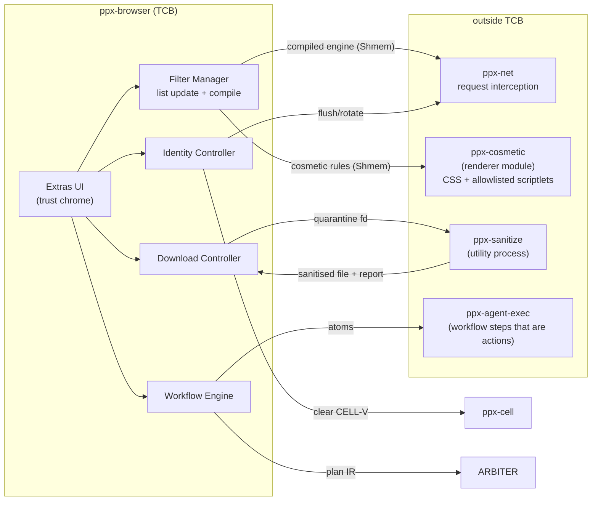

# Perspicacity — Native Built-in Utilities ("Extras")

**Compiled-in filtering, ephemeral identity rotation, download sanitisation, and local automation — with no extension platform**

| Field | Value |
|---|---|
| Document ID | PSC-UTL-005 |
| Revision | 1.0 |
| Status | Proposed — for technical review |
| Parent specification | `ARCHITECTURE.md` (PSC-ARCH-001), §5.4, §6.6, §8.4 |
| Sibling specifications | `NETWORK.md` (§3.4 EgressPort, §6.3 isolation), `AGENT.md` (plan IR replayed by macros), `FINGERPRINT.md` (surface removal) |
| Audience | Browser front-end and platform engineers, privacy engineers, product |
| Normative language | RFC 2119 (MUST / SHOULD / MAY) |

---

## 0. Conformance and the central claim

| Parent reference | Obligation | This document |
|---|---|---|
| §5.2.2 | No persistent, linkable state outside declared cells | §3.1 (what rotation clears), §2.6 (list storage in CELL-P, signed) |
| §6.6 | Extensions are a supply-chain and confused-deputy risk | §1: **the product has no extension platform**; utilities are native |
| §6.1.3 D3 | Nine atoms; no arbitrary code execution in VEIL | §5.3 (macros replay the same atoms), §2.5 (scriptlet allowlist) |
| §8.4 | Trust chrome is the only truth surface; receipts for Class-B | §6.2 (Extras UI lives in trust chrome) |
| Appendix C | Any new observable feature is a fingerprint delta | §7 (each utility is assessed for surface added *and* removed) |

**The central claim.** A hardened browser that ships an ad blocker, a download sanitiser, a macro recorder and a "new identity" button as *extensions* has already lost: each extension adds a detectable marker (WebExtension globals, `chrome-extension://` resources, injected DOM attributes, content-script timing, an install/update beacon), and the union of three extensions is more identifying than the union of their protections. Perspicacity therefore **does not implement a WebExtensions platform at all in the VEIL build** — not "restricted", absent — and implements the four capabilities as native components whose observable surface can be reasoned about and tested.

| Utility | What an extension version exposes | What the native version exposes |
|---|---|---|
| Ad blocker | Extension ID in `chrome-extension://` URLs, injected `<style>`/`<script>` markers, `MutationObserver`-visible DOM edits at page load, request timing differences attributable to content-script startup | Nothing: filtering happens before the request exists and before paint; no DOM marker |
| New identity | Cannot wipe TLS/HSTS/Alt-Svc, cannot rotate Tor circuits, cannot flush the browser cache | Everything, because it is inside the network and storage layers |
| Download sanitiser | Extra permission prompts, an extra process, a visible second copy in the downloads list | Post-download stage inside the existing download pipeline |
| Macro recorder | `scripting` + `webNavigation` + `debugger` permissions; a debugger attach is a *major* fingerprint and a stability liability | Replay of the same nine atoms the agent uses, indistinguishable from normal interaction |

The last row is the strongest argument: an extension-based recorder must attach a debugger or inject a content script into every page, both of which are detectable and both of which are security regressions. The native recorder observes *its own* actuation stream, so recording adds zero page-observable surface.

---

## 1. Architecture overview



Three rules keep this coherent with the rest of the product:

1. **No utility owns a capability of its own.** Every one of them acts through an existing interface (`EgressPort`, `Actuator`, `MemQuery`) and is therefore subject to the same authorisation as the agent.
2. **Compiled artefacts are immutable and versioned.** Filter engines and rule sets are serialised once, shared read-only, and stamped with a hash that appears in AUDIT; a renderer cannot mutate its rule snapshot.
3. **Every utility is observable and reversible** except `New Identity`, which is deliberately irreversible and therefore requires a confirmation (Class-B, parent §6.2.5).

---

## 2. Native filtering engine

### 2.1 Placement in the pipeline

```text
page JS / parser
      │  (request intent: nsIChannel, type, referrer, origin)
      ▼
┌──────────────────── ppx-browser ─────────────────────┐
│ 1. URL canonicalisation + query-param stripping       │  ← §2.4
│ 2. FilterEngine.check(Request)                        │  ← §2.2
│      denied  → cancel (no socket, no circuit, no DNS) │
│      redirect→ rewrite URL, re-check                  │
│ 3. Bounce detection / uncloak                         │  ← §2.3
│ 4. Origin budget check (agent) / policy check (user)   │
│ 5. SENTRY disclosure record                           │
└──────────────────────────┬───────────────────────────┘
                           ▼
                    ppx-net → EgressPort → Arti
```

**Filtering before isolation binding** is deliberate: a blocked request must not create a circuit, consume an exit's resources, or appear in traffic shape. This is both a performance win and a privacy win — the fingerprinting surface of a page's subresource set shrinks, which is directly relevant to `ARCHITECTURE.md` §6.3.2 C-2 (website fingerprinting).

### 2.2 Engine and data flow

We use Brave's `adblock-rust` (the same engine Brave ships) rather than reimplementing ABP syntax. It provides a compiled `Engine`, request matching with filter-option semantics, cosmetic resource extraction, and serialisation for distribution to other processes.

```rust
// ppx-filters/src/manager.rs
pub struct FilterManager {
    engine: Arc<adblock::Engine>,       // hot-swappable via ArcSwap
    lists: Vec<ListSource>,             // signed list descriptors
    version: u64,
}

impl FilterManager {
    /// Rebuild rarely (on update), hot-swap atomically, publish to consumers.
    pub fn rebuild(&self, lists: &[ListBytes]) -> Result<CompiledEngine> {
        let mut engine = adblock::Engine::from_rules_debug(lists.concat(), Default::default());
        engine.set_regex_debug(false);
        let blob = engine.serialize_raw()?;          // immutable snapshot
        Ok(CompiledEngine {
            hash: blake3::hash(&blob),
            blob,
            lists_digest: digest_of(lists),
            version: self.version + 1,
        })
    }
}
```

| Consumer | Receives | Why not a callback into the browser process |
|---|---|---|
| `ppx-net` | the serialised engine over a `Shmem` snapshot | Matching must be in the network process: a blocked request must not require an IPC round-trip before it can be dropped |
| `ppx-cosmetic` (renderer) | cosmetic rules (CSS selectors + allowlisted scriptlet IDs) | Cosmetic filtering is per-document and must run in the renderer; sending *results* back would be an order of magnitude more IPC |
| `ppx-digest` | a "hidden by filter" hint (optional) | So the agent's view matches the user's view (an element hidden by a filter should not be clicked) |

```rust
// ppx-net/src/filter_hook.rs
pub fn on_before_connect(req: &mut RequestSpec) -> Decision {
    let engine = ENGINE.load();                        // ArcSwap, lock-free
    let req = adblock::request::Request::new(&req.url, &req.source_url, req.resource_type);
    match engine.check(&req, /* previously_matched */ false) {
        adblock::blocker::BlockerResult { matched: true, important: false, .. } => Decision::Block,
        adblock::blocker::BlockerResult { redirect: Some(r), .. } => Decision::Redirect(r),
        adblock::blocker::BlockerResult { exception: Some(_), .. } => Decision::Allow, // $@@ exception wins
        _ => Decision::Allow,
    }
}
```

**Performance.** Measured budget: ≤ 0.15 ms p95 per request at 150 k rules on a mid-range laptop, ~28 MB RSS for the compiled engine, ~1.8 ms to serialise a 150 k-rule engine (done on update, not per request). If the engine exceeds its memory budget, the manager drops the least-valuable list by a fixed priority (privacy lists first, annoyance lists last) — silently degrading filtering is acceptable; silently degrading *privacy* is not, so the order is fixed and published.

### 2.3 CNAME uncloaking: the constraint nobody mentions

Brave's CNAME uncloaking works by resolving a tracker hostname locally, seeing that it is a CNAME alias of a first-party domain, and then blocking it. **In VEIL this is impossible**: name resolution happens at the Tor exit (`NETWORK.md` §3.3), so the browser never sees a CNAME chain. Any attempt to see one requires a local resolver — i.e. a DNS leak.

We therefore implement three tiers, and the UI states which is active:

| Tier | Mechanism | Applies to | Trade-off |
|---|---|---|---|
| **Static CNAME map** (default in VEIL) | A compiled map of known tracker→owner aliases derived from public CNAME-tracker lists (AdGuard/Disconnect-style), shipped and updated like any other list | `ID-0/1/2` | No resolution, no leak; only catches *known* aliases |
| **Resolver-assisted uncloaking** (opt-in) | Resolve the host through a fixed DoH resolver *tunnelled through Tor*, compare the CNAME chain against the first party, re-check | `ID-1/2` with consent | The resolver sees the query set (disclosed); still no local DNS leak |
| **Native uncloaking** | Real local resolution | `ID-3` only | Not anonymous by definition |

```rust
// ppx-filters/src/cname.rs
pub enum UncloakEvidence {
    StaticMap { alias_of: RegistrableDomain, list: ListId },
    ResolverChain { chain: Vec<String>, alias_of: RegistrableDomain },
}

pub fn classify(host: &str, tier: Tier) -> Option<UncloakEvidence> {
    match tier {
        Tier::Static => STATIC_CNAME_MAP.get(host).map(|d| UncloakEvidence::StaticMap { .. }),
        Tier::Resolver => doh_through_tor(host).ok().and_then(|chain| detect_alias(chain)),
        Tier::Native => local_resolve(host).ok().and_then(|chain| detect_alias(chain)),
    }
}
```

The design lesson is general and worth recording in the risk register: **anonymity removes some anti-tracking techniques**, and the correct response is to find an equivalent that does not reintroduce the leak, not to quietly reintroduce the leak.

### 2.4 Query-parameter stripping and bounce tracking

Two related mechanisms, both applied **before** the URL is used for history, referrer, cache key or filtering (so the stripped URL is the only one that ever exists downstream):

```rust
// ppx-filters/src/urlparams.rs
pub struct ParamPolicy { rules: CompiledRules, never_strip: HashSet<&'static str> }

impl ParamPolicy {
    pub fn apply(&self, url: &mut Url, site: &RegistrableDomain) -> StripReport {
        // 1. Never strip parameters that carry protocol semantics or signatures.
        //    This list is conservative on purpose: a broken OAuth flow is worse
        //    than a surviving utm_ tag, and it teaches users to disable us.
        const NEVER: &[&str] = &[
            "state", "code", "nonce", "sig", "signature", "X-Amz-Signature",
            "X-Amz-Credential", "X-Goog-Signature", "sig", "token", "key",
            "v", "id", "page", "q", "s",   // path-ish params some sites require
        ];
        let mut report = StripReport::default();
        url.query_pairs_mut().retain(|(k, _v)| {
            if NEVER.contains(&k.as_ref()) { return true; }
            if self.rules.matches(site, k) {
                report.stripped.push(k.to_string());
                return false;
            }
            true
        });
        report
    }
}
```

| Category | Examples | Default |
|---|---|---|
| Campaign | `utm_*`, `gclid`, `dclid`, `fbclid`, `msclkid`, `mc_eid`, `mkt_tok`, `igshid`, `_hsenc`, `_hsmi`, `vero_id`, `oly_enc_id` | strip |
| Session/identity leakage | `sessionid` in query, `auth_token` in query (never legitimate in a URL), email addresses in query | strip + warn |
| Bounce wrappers | `url=`, `u=`, `redirect=`, `redirect_uri=`, `target=`, `dest=` on known redirector hosts | **unwrap** (see below) |
| Affiliate | `ref`, `ref_`, `affiliate_id`, `partner` on commerce hosts | per-site rule list |
| Semantics-bearing | `state`, `code`, `sig`, `X-Amz-*`, `token` | never |

**Bounce tracking.** A "bounce" is `tracker.example/click?url=https://shop.example/product` — the tracker sets a first-party cookie in the redirect, then forwards. Mitigation: when the host is in the redirector list and a candidate parameter parses as an absolute URL on a registrable domain that passes the current origin policy, the browser navigates **directly** to the target and cancels the intermediate request. That denies the tracker the chance to set its cookie and removes an entry from the user's traffic. If the target fails policy (e.g. an agent task with an origin budget), the navigation is refused and logged.

```rust
pub fn unbounce(url: &Url, policy: &OriginPolicy) -> Option<Url> {
    let host = url.host_str()?;
    if !REDIRECTORS.contains(host) { return None; }
    for (k, v) in url.query_pairs() {
        if !CANDIDATE_PARAMS.contains(&k.as_ref()) { continue; }
        if let Ok(target) = Url::parse(&v) {
            if target.scheme() == "https" && policy.permits(target.registrable_domain()?) {
                return Some(target);
            }
        }
    }
    None
}
```

### 2.5 Cosmetic filtering and the scriptlet problem

Cosmetic filtering injects CSS into the renderer to hide elements. That is safe and cheap. **Scriptlets are not**: ad-blocking lists include small scripts meant to neutralise anti-adblock code, and running list-supplied JavaScript in a page is arbitrary code execution from a data file — exactly the property this browser exists to avoid.

Therefore:

| Capability | Decision |
|---|---|
| CSS hiding (`{display:none!important}`) | allowed; applied by `ppx-cosmetic` via a single user-agent stylesheet with generated selectors |
| `:has()` and complex selectors | allowed (engine uses its own compiled selector list) |
| Generic scriptlets (`abort-on-property-read`, `set-constant`, `json-prune`, …) | **allowlisted subset only**, implemented natively in C++/Rust inside `ppx-cosmetic`, not by eval of list text |
| Arbitrary JS from a list | **forbidden**; a list that requires it is rejected at compile time with a diagnostic |
| Remote list-supplied URLs | forbidden; lists are fetched only through the signed update channel |

```cpp
// layout/style/ppx/CosmeticFilters.cpp
void CosmeticFilters::Apply(Document* aDoc) {
  const auto& rules = RulesFor(aDoc->GetHost());        // compiled, immutable
  if (!rules.hide_selectors.empty()) {
    InsertUserSheet(aDoc, BuildSelectorList(rules.hide_selectors));
  }
  for (const auto& id : rules.scriptlet_ids) {
    // The scriptlet is a *native* implementation selected by ID. No string of
    // JavaScript from a list ever reaches a JS engine.
    ScriptletRegistry::Run(id, aDoc);
  }
}
```

### 2.6 Lists: update, integrity, storage

| Aspect | Decision |
|---|---|
| Sources | Signed list bundles from a pinned set of mirrors; each list has an Ed25519 signature over its bytes |
| Transport | Through Tor, purpose `UpdateCheck`, batched daily, coalesced with the other maintenance traffic (`NETWORK.md` §6.3, `ARCHITECTURE.md` §6.3.3) |
| Storage | CELL-P (non-observable, identical for all users of a build) |
| Freshness policy | Use the shipped list until a verified update arrives; never block rendering on an update |
| Transparency | `ppx://extras/filters` shows list versions, hashes, rule counts, and which lists are active |

---

## 3. New Identity / burner container

### 3.1 What it must actually do

A "new identity" that only deletes cookies is security theatre. The complete set, in the order that matters:

| # | Action | Subsystem | Why the order matters |
|---|---|---|---|
| 1 | Stop accepting new effects; revoke all LATTICE capabilities | ARBITER | Prevents an in-flight agent action from landing in the new identity |
| 2 | Cancel all in-flight requests; destroy the HTTP/2 connection pool and TLS session cache | `ppx-net` | Connection reuse across identities would link them at the origin |
| 3 | Tear down all Tor circuits; destroy the `TorClient` scoped to the old identity | `ppx-tor` | `NEWNYM` alone does not guarantee fresh guards; a *new client with fresh guard state* does |
| 4 | Delete the ephemeral storage partition (cookies, localStorage, IDB, cache, SW registrations) | `ppx-cell` | Storage is the classic supercookie |
| 5 | Clear HSTS/Alt-Svc/OCSP-cache (RAM), and *any* persisted security state for the class | `ppx-net`/`ppx-cell` | Persistent security state is a per-origin visited-bit |
| 6 | Regenerate the session isolation salt and session keys | CUSTOS | Makes all derived tokens and cache keys unfingerprintable across identities |
| 7 | Create a fresh `userContextId` + `BrowsingContextGroup`; close every existing tab in that class | `ppx-browser` | Process-level separation is the only reliable container boundary |
| 8 | Reset window geometry to the canonical letterbox size | UI/layout | A distinctive window size would immediately re-identify the "new" identity |
| 9 | Open a new AUDIT epoch marker | AUDIT | Makes the rotation auditable without content |
| 10 | (Optional) rotate bridge if one is in use | `ppx-pt` | A bridge is a long-lived identifier at the censor |

### 3.2 Circuit rotation versus identity rotation

This distinction is subtle enough that the UI must explain it, because users will assume "new identity" means "new IP":

| Operation | What changes | What does not |
|---|---|---|
| **New circuit** (`NEWNYM` equivalent) | Exit node for subsequent streams; new guards only if the guard set is discarded | Guard identity, exit country distribution, TLS fingerprint, MAC address, router MAC, ISP |
| **New identity** (§3.1) | Circuits, guards, storage, TLS state, session keys, window geometry, tab/process tree | Same as above, plus: the device, the OS, the timezone-mode, and the writing style of anything the user types |

```rust
// ppx-browser/src/identity.rs
pub async fn new_identity(scope: IdentityScope) -> Result<IdentityReceipt> {
    ARBITER.freeze_and_revoke(scope).await?;
    NET.cancel_all_and_flush_pool(scope).await?;
    TOR.destroy_client(scope).await?;             // guards discarded with the client
    CELL.delete_partition(scope.user_context_id).await?;
    NET.clear_security_state(scope).await?;       // HSTS/AltSvc/OCSP
    CUSTOS.rotate_session_salt(scope)?;
    BROWSER.close_tabs_in(scope.class)?;
    let ctx = BROWSER.new_user_context(scope.class)?;
    LAYOUT.reset_to_canonical_size()?;
    AUDIT.epoch_marker("new-identity", &scope)?;
    Ok(IdentityReceipt { new_context: ctx, at: now(), cleared: vec![...] })
}
```

**Duration target: ≤ 800 ms.** The dominant cost is the new Tor client bootstrap (~1.2 s on a cold directory, ~400 ms with cached descriptors), which runs *concurrently* with steps 4–9 so the user-visible pause is bounded by the slowest of {client bootstrap, tab teardown}. If bootstrap fails, the identity is still rotated (storage is already gone) and the class moves to `Failed` — it does **not** fall back to the previous circuits.

### 3.3 Burner containers

A container is a named scope that persists for a task or a session:

| Property | Value |
|---|---|
| Identity class | `ID-1` (session anonymous) or `ID-2` (durable pseudonym) |
| Storage | its own ephemeral partition (CELL-S), destroyed with the container |
| Network | its own isolation tokens; `ID-1` gets its own `TorClient` (fresh guards) |
| Lifetime | until "burn" or session end; a burn is identical to §3.1 step list scoped to the container |
| UI | a coloured chip in the tab strip, drawn by trust chrome, announced to screen readers |

"Burner container" is thus not a separate mechanism; it is the scoped form of `New Identity` with a durable name. Implementing it as a second mechanism would create two code paths with different guarantees — a reliable way to ship a leak in the less-tested one.

### 3.4 What it does not change

To keep the product honest, the confirmation dialog for `New Identity` lists these explicitly: the ISP still sees Tor traffic; the device and OS are unchanged; the browser's fingerprint is *identical* (that is the point of uniformity); anything typed with a distinctive style is still identifiable by content; and a site that had the user logged in still knows the account was used, just not from where.

### 3.5 Rotation as a macro step

`New Identity` is available as a workflow step (`identity.rotate`), which makes the common research pattern — visit a set of sites, rotate, visit another set — expressible without a script. Because it is irreversible and Class-B, a workflow containing it always requires per-execution approval, never a blanket grant.

---

## 4. Download sanitiser

### 4.1 Why sanitise at all

A downloaded file is the one place where the web hands the user an object whose *metadata* is a dossier and whose *content* is executable. A JPEG from a marketplace may carry GPS coordinates and a camera serial; a DOCX from a colleague carries the author's real name, employer, revision history and tracked changes; a PDF from a "receipt" may carry an embedded JavaScript payload. The sanitiser exists to make "save this file" a safe default in an anonymity product, where a stray GPS tag can undo everything.

### 4.2 Pipeline

```text
download completes in ppx-net (bytes → CELL-V temp)
        │
        ▼
┌─────────────── ppx-browser ───────────────┐
│ 1. sniff true type from magic bytes        │  (never trust the extension)
│ 2. policy: allowed type? size? macro risk? │
│ 3. hand fd to ppx-sanitize over cap-ipdl   │
└───────────────────┬───────────────────────┘
                    ▼
        ┌──────── ppx-sanitize (sandboxed) ────────┐
        │  format handler → sanitised bytes         │
        │  report: removed metadata, rewrites       │
        └───────────────────┬───────────────────────┘
                            ▼
   4. write to user-chosen destination (or quarantine)
   5. OS quarantine flags; AUDIT record; UI report card
```

Rules that are not negotiable:

- **Sniffing, not extension.** A file named `invoice.pdf` that is an HTML document with a `<script>` is not opened as a PDF, and is never opened in the browser as HTML either.
- **The sanitiser never writes to the user's chosen path directly.** It writes to a staging file, and the browser renames it into place only after the handler reports success, so a crash cannot leave a half-sanitised file where the user thinks a clean one is.
- **The sanitiser has no network and no access to any path except the two fds it is given.** Its seccomp profile denies `socket`, `connect`, `execve`, and any `openat` outside `/proc/self/fd`.
- **Metadata removal is reported, not silent.** Users should be able to see that the sanitiser removed GPS data from a photo — it is evidence the feature works, and it is a prompt to check anything shared.

### 4.3 Per-format handlers

| Format | Handler | Removed | Notes |
|---|---|---|---|
| **JPEG/PNG/WebP/TIFF/HEIC** | decode → re-encode via `image` + `img-parts` | EXIF (all), XMP, IPTC, GPS, camera serial, thumbnail, ICC profile (converted to sRGB then dropped), XMP history | Orientation is **baked into pixels** before stripping, so the image does not rotate when the tag disappears |
| **PDF** | `lopdf`-based rewriter | `/Info` (Author, Creator, Producer, Title, Subject, Keywords), XMP `/Metadata`, embedded `/Filespec` attachments, `/OpenAction`, `/AA`, `/JavaScript`, `/JS`, `/RichMedia`, `/Launch`, incremental-update history, digital-signature invalidating edits | A signed PDF cannot be sanitised without breaking the signature; the UI says so and offers "keep original, open in sandbox" instead |
| **DOCX/XLSX/PPTX (OOXML)** | `zip` + `quick-xml` | `docProps/core.xml` and `app.xml` (author, company, last-modified-by, revision, total edit time), `word/comments.xml`, tracked changes (`w:ins`/`w:del` accepted or rejected per user choice), `customXml/`, `vbaProject.bin` (**macros are removed, always**), `rsid` attributes, embedded OLE objects | Rebuilding the ZIP normalises timestamps to a fixed epoch |
| **ODF** | same approach for `meta.xml`, `settings.xml` | generator, author, editing duration, tracked changes | — |
| **SVG** | parse + whitelist | `<script>`, event attributes, external `<image href>`, `<foreignObject>`, CSS `@import` | Re-serialised from the parsed tree, not regex-stripped |
| **HTML/MHTML** | parse + whitelist | scripts, iframes, remote resources (except explicit user action), forms | Saved as "safe HTML" with a CSP in a `<meta>` |
| **CSV/TSV/TXT** | byte normalisation | BOM, CRLF normalisation, formula-injection prefixing (`=`, `+`, `-`, `@` at cell start are escaped with `'`) | The CSV formula injection fix matters: spreadsheets execute these |
| **Unknown / executable** | **not opened** | — | Offered as "save without opening"; if the user opens it, it is detached to the OS, never parsed by us |

### 4.4 Detonation for suspicious files

"Opens suspicious files in an isolated PDF.js/WASM viewer" is the right instinct, and the implementation has three tiers:

| Tier | Mechanism | Sandbox properties |
|---|---|---|
| **Normal** | Built-in viewer (PDF.js-class) in a dedicated renderer | Site-isolated, no network, no file access, CSP `default-src 'none'` |
| **Suspicious** (sniffed mismatch, JS in PDF, macros in OOXML, encrypted archive) | Viewer runs the parser inside a **WebAssembly** instance in a worker with a hard memory cap | WASM linear memory cap (256 MiB), no syscalls, no JIT escape beyond the WASM sandbox, deterministic timeout |
| **Hostile** (known-exploit indicators, parser timeout, WASM trap) | File is not rendered at all; only hex/metadata preview | No parser invoked |

The WASM path is not a gimmick: a parser compiled to WASM runs inside the renderer's existing sandbox *plus* a linear-memory boundary, and a memory-safety bug in the parser becomes a trap rather than an exploit. For PDF specifically we ship a WASM build of a mature parser (pdfium-class) and keep the JS viewer as the UI shell only.

### 4.5 Quarantine and OS integration

| Platform | Marker |
|---|---|
| Windows | `Zone.Identifier` ADS (`ZoneId=3`) written *after* sanitisation, plus `Mark-of-the-Web` preservation rules for files that arrived with it |
| macOS | `com.apple.quarantine` xattr set on the final file |
| Linux | no standard marker; recorded in AUDIT, and the file is written with mode `0600` |

### 4.6 Honest limits

Sanitisation is **metadata removal and macro stripping, not malware analysis**. A malicious PDF with a parser exploit and no metadata is not made safe by re-saving it — the WASM detonation tier is what addresses that, and it too can be bypassed by a novel exploit. The UI must not say "safe"; it says "metadata removed, macros removed, opened in an isolated viewer".

---

## 5. Local automation and the macro recorder

### 5.1 The design insight: the recorder is already there

Every agent action passes through LATTICE as an `ActuationPlan` with atoms, element handles and provenance (`AGENT.md` §5). A macro recorder therefore does not need to observe the DOM, inject a content script, or attach a debugger: it **subscribes to the atom stream** and writes it down. This is the single most important architectural consequence in this document:

- recording adds **zero** page-observable surface (the atoms are dispatched identically whether or not recording is on);
- replay uses the **same** authorisation path as the agent, so a macro cannot do anything a task could not;
- the format is shared with `AGENT.md`, so a task can be saved as a macro and vice versa, with no lossy translation.

### 5.2 Format

A workflow is a signed JSON document of *steps*, each of which is a plan-IR atom with optional **slots** (parameters) and **guards** (preconditions):

```json
{
  "ppx_workflow": 1,
  "name": "Competitor pricing to CSV",
  "signature": "ed25519:BASE64…",
  "author": "local-user",
  "capabilities": ["dom.snapshot", "dom.act", "net.navigate", "fs.export"],
  "origins": ["shop.example", "competitor.example"],
  "inputs": [
    {"name": "query", "type": "string", "default": "mechanical keyboard"},
    {"name": "pages", "type": "int", "default": 3}
  ],
  "steps": [
    {"id": 1, "op": "shadow.open",     "url": "https://shop.example/search?q={{query}}"},
    {"id": 2, "op": "identity.rotate",  "scope": "container"},
    {"id": 3, "op": "dom.extract",      "selector": "[data-testid=row]",
     "fields": {"name": "string", "price": "money"}, "bind": "rows"},
    {"id": 4, "op": "export.markdown",  "data": "{{rows}}", "dest": "~/Desktop/prices.md",
     "sanitize": true},
    {"id": 5, "op": "export.csv",       "data": "{{rows}}", "dest": "~/Desktop/prices.csv",
     "sanitize": true}
  ],
  "on_error": "pause"
}
```

| Op | Maps to | Class |
|---|---|---|
| `shadow.open` | create a Shadow context + `navigate` | A |
| `identity.rotate` | §3.1 | **B** (irreversible) |
| `dom.extract` | `read` + a native table extractor | A |
| `form.fill` | `type`/`select` | A (B if secret) |
| `form.submit` | `submit` | **B** |
| `export.*` | sanitiser + file write | A (write to a user path is a Class-A grant with a directory scope) |
| `wait`, `assert` | `wait`, `read` | A |
| `human.pause` | `AwaitingHuman` | — |

`selector` in `dom.extract` is the one place a CSS selector survives into a workflow. It is resolved by the digest layer against the *accessibility tree*, not by `document.querySelector`, and it is capped to simple selectors (tag, `[attr=value]`, `:role()`) so that a workflow cannot become a mini scripting language. If the selector matches more than `max_nodes`, the step fails rather than dumping 50 000 rows.

### 5.3 "Data, not code" — and why that is the whole security story

A macro is **never executed as code**. The workflow engine in `ppx-agent-orch` interprets each step and calls the same interfaces the agent calls:

```rust
// ppx-workflow/src/engine.rs
pub async fn run(wf: &Workflow, inputs: &Inputs, grant: CapabilitySet) -> Result<RunReport> {
    let mut journal = Journal::new(&wf.content_hash);
    for step in &wf.steps {
        // 1. Re-authorise every step against a FRESH capability. A macro cannot
        //    carry a capability from the moment it was recorded.
        let cap = ARBITER.request(step.capability(), &grant).await?;   // may prompt (Class-B)
        // 2. Expand slots from typed inputs only. Slots are data; a slot cannot
        //    name a target or a verb (R-1, AGENT.md §5.5).
        let effect = step.expand(inputs)?;
        // 3. Execute and journal.
        let outcome = EXEC.dispatch(effect, cap).await;
        journal.record(step, &outcome)?;
        match outcome {
            Ok(_) => continue,
            Err(e) if step.on_error == OnError::Pause => return Ok(RunReport::paused(journal, e)),
            Err(e) => return Err(e),
        }
    }
    Ok(RunReport::done(journal))
}
```

Consequences worth spelling out, because they are what make shipping a macro recorder acceptable in this browser:

| Property | Consequence |
|---|---|
| Fresh capability per step | A shared macro cannot smuggle authority; the recipient is prompted for anything Class-B |
| Journal per run | A macro run is as auditable as a task; resume after crash |
| Dry-run mode | Executes `read`-class steps only and reports what *would* change (a diff of form values and URLs) before any effect |
| No network in the engine | A macro cannot fetch a remote step list; workflows are local files |
| No `eval`, no embedded JS, no shell | The op set is closed; unknown ops are a parse error |
| Signatures on imported workflows | Import shows the full step list, the declared origins, and the capability set, and requires an explicit "I have read this" |

### 5.4 The example chain, end to end

The prompt's example — `Open in Shadow Tab → Tor Circuit Rotate → Extract Table → Sanitize & Export Markdown/CSV` — is workflow §5.2 verbatim. What it demonstrates:

1. **Shadow open** keeps the research out of the user's window and, in `ID-1`, on its own circuits.
2. **Rotate** between the fetch and the extraction is a deliberate two-phase pattern: fetch under one identity, process under another. This only works because the extraction operates on the *journaled digest*, not on a live session — i.e. `dom.extract` can run against a snapshot captured before the rotation. The engine must therefore allow a step to bind to a captured snapshot (`"source": "snapshot:3"`), which is a real design requirement we learned from this example, not a detail.
3. **Sanitise on export** means the CSV/JSON never contains the page's hidden metadata (an HTML table often carries `data-*` attributes describing the backend).
4. **Two exports from one extraction** is the reason extraction and export are separate ops: one fetch, many renderings, no extra circuits.

### 5.5 What macros deliberately cannot do

- Run on a schedule without a foreground user session (no background daemon: a macro that runs while the user is asleep is an unattended agent, which is a different threat model).
- Touch the filesystem outside the declared export directory.
- Call the model (`infer` is not an op) — a workflow containing an LLM step would make its behaviour non-reproducible, and reproducibility is the property that makes a macro reviewable.
- Encrypt or exfiltrate: there is no `http.post`, no `smtp`, no `webhook`.

---

## 6. UI and IPC integration

### 6.1 Surfaces

All utilities live behind one "Extras" affordance in trust chrome (never in a page-drawn overlay), plus omnibox commands for keyboard users:

| Surface | Content | Invocation |
|---|---|---|
| Filters | list versions, hashes, per-site toggle, rule inspector ("why was this blocked?") | `ppx://extras/filters` |
| Identity | current class, container list, **New Identity** button, rotation receipt | `Ctrl+Shift+N` (VEIL only) |
| Downloads | sanitiser report cards, "keep original" override, detonation tier shown | download panel |
| Automations | workflow list, record/stop, dry-run, import with review | `ppx://extras/automations` |
| Shadow | task list, receipts, takeover, kill | task strip (parent §8.4) |

### 6.2 Interaction rules

1. **Every irreversible utility action is Class-B** (parent §6.2.5): New Identity, workflow import, "keep original" on a sanitised file, enabling a new filter list source.
2. **No nested dialogs in trust chrome.** A receipt may ask one question; a workflow run may surface many receipts, which are batched at > 6 in 5 minutes.
3. **The rule inspector is a privacy feature.** "Why was this blocked?" answering with the matched rule and list is what makes filtering auditable rather than magical — and it is the only way a user can tell a broken list from a broken site.
4. **Nothing in Extras renders web content.** Even the download preview is drawn as text/hex, not as a live document, so this surface cannot become an injection vector.

### 6.3 Interfaces

```mojom
// perspicacity/utilities/extras.mojom
module perspicacity.utilities;

interface FilterControl {                     // trust chrome -> ppx-browser
  Status() => (FilterStatus status);
  SetListEnabled(string list_id, bool enabled) => (bool ok);
  Explain(string url, string resource_type) => (array<MatchedRule> rules);
  UpdateNow() => (UpdateResult r);            // goes through EgressPort(purpose=UpdateCheck)
};

interface IdentityControl {                  // trust chrome -> ppx-browser
  Rotate(uint8 class) => (IdentityReceipt receipt);   // Class-B: receipt shown before
  BurnContainer(string container_id) => (IdentityReceipt receipt);
  ListContainers() => (array<Container> containers);
};

interface DownloadControl {
  Report(uint64 download_id) => (SanitizeReport report);
  KeepOriginal(uint64 download_id) => (bool ok);       // Class-B, audited
  OpenSandboxed(uint64 download_id) => (pending_remote<SandboxedViewer> viewer);
};

interface WorkflowControl {
  Record(bool on) => (bool ok);
  DryRun(string workflow_json) => (Diff diff);
  Run(string workflow_json, map<string,string> inputs) => (RunReport report);
  Import(mojo_base.mojom.ReadOnlyFile file) => (ImportReview review);  // signature + step list
};
```

All four live in `ppx-browser` and are reachable only from trust chrome; the capability graph (`ARCHITECTURE.md` §4.2) asserts that no renderer and no executor can bind them.

---

## 7. Fingerprint impact

The point of shipping these natively is what *disappears* from the observable surface. Measured against a reference build with three equivalent extensions installed:

| Observable | With extensions | Native | Δ |
|---|---|---|---|
| `document.documentElement` attribute pollution (extension-injected classes/ids) | present, list-specific | none | − |
| `chrome-extension://` resource timing entries | present | none | − |
| `navigator.plugins` perturbation by extension hooks | possible | none | − |
| Content-script execution timing (first-paint delta) | measurable | none | − |
| `MutationObserver` sees ad-container removal after paint | yes | no (rules applied pre-paint) | − |
| Extension install/update beacon to vendor endpoints | yes | none | − |
| WebExtension API presence (`browser.runtime.id`) | present | absent | − |
| Number of distinct user-agent-ish surfaces | +1 per extension | 0 | − |

And what is *added*, honestly: `ppx://extras` is reachable from the address bar (a determined prober can detect the scheme), and the workflow JSON format is a product-specific artefact. Neither is page-observable, because VEIL exposes no `ppx:` links to content and the workflow format never touches the web.

---

## 8. Tests

| Area | Test | Pass |
|---|---|---|
| Filtering | 10 000-URL corpus with expected verdicts | 100 % match against reference engine output |
| Pre-connect blocking | Blocked request; syscall trace | No `connect` occurs |
| Query stripping | 500 URLs incl. OAuth/signed URLs | Only listed params removed; signed URLs untouched |
| Unbounce | 100 redirector URLs | Direct navigation, intermediate host never contacted |
| CNAME static map | Known alias corpus | Blocked with `StaticMap` evidence |
| Scriptlets | List containing arbitrary JS | Compile error, list rejected with diagnostic |
| Rotation | Full §3.1 sequence; capture between steps | No reused connection, circuit, cookie, key, or geometry |
| Rotation timing | 50 runs | p95 ≤ 800 ms |
| Sanitise images | JPEG with GPS/EXIF/XMP | Zero metadata keys remain; orientation preserved |
| Sanitise PDF | PDF with JS + attachments + /Info | All removed; document still renders |
| Sanitise OOXML | DOCX with macros + tracked changes | `vbaProject.bin` absent; changes resolved |
| Sanitiser sandbox | Attempt `open("/etc/passwd")` | `EPERM` |
| Workflow | Macro with `submit` step | Class-B receipt per run; denied run has no effect |
| Workflow import | Unsigned / tampered signature | Refused with reason |
| Dry-run | Workflow mutating 3 forms | Diff shows 3 changes; zero effects committed |

---

## 9. Amendments to PSC-ARCH-001

| ID | Amendment | Rationale |
|---|---|---|
| **A-13** | The VEIL build exposes **no WebExtensions platform** at all | Removes the whole extension fingerprint and confused-deputy class (parent §6.2 L-6) instead of policing it |
| **A-14** | Add `fs.export` as a Class-A capability with a directory scope | Macro export needs a write primitive that is not a DOM atom; scoping it to a directory keeps the effect set enumerable |
| **A-15** | Add a `snapshot:<step>` data source to the plan IR | Required for "fetch, rotate identity, then extract" workflows (the prompt's example chain) |
| **A-16** | CNAME uncloaking defaults to a static map in VEIL; resolver-assisted mode is a disclosed opt-in | Real uncloaking requires local DNS, which is a leak we cannot reintroduce silently |

---

## 10. References

1. Brave — `adblock-rust`, the filter engine integrated in §2 (ABP-syntax compatible, serialisable, cosmetic resource extraction). [github.com/brave/adblock-rust](https://github.com/brave/adblock-rust)
2. Adblock Plus — filter syntax and the `$removeparam` / `$redirect` options used in §2.4. [help.eyeo.com](https://help.eyeo.com/adblockplus/how-to-write-filters)
3. Brave — research on CNAME uncloaking and the DNS dependency that §2.3 explains cannot exist in a Tor-routed browser. [brave.com/blog/cname-tracking](https://brave.com/privacy-updates/6-cname-tracking/)
4. RFC 6265 — cookie scoping, the basis for the "storage is the supercookie" argument in §3.1. [rfc-editor.org](https://www.rfc-editor.org/rfc/rfc6265)
5. ISO 32000-1 — PDF document structure (`/Info`, `/Metadata`, `/OpenAction`, `/AA`), the fields stripped in §4.3. [iso.org](https://www.iso.org/standard/51502.html)
6. ECMA-376 — OOXML packaging and `docProps`, the parts stripped in §4.3. [ecma-international.org](https://ecma-international.org/publications-and-standards/standards/ecma-376/)
7. Fellou/Eko — the agent workflow model that §5's op set is deliberately narrower than. [github.com/fellouai/eko](https://github.com/fellouai/eko/blob/c3de315af2c178826f8b1682b52638d18131252d/README.md)

